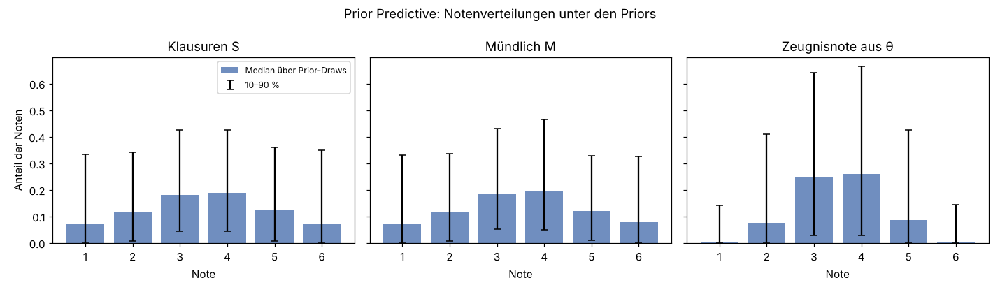
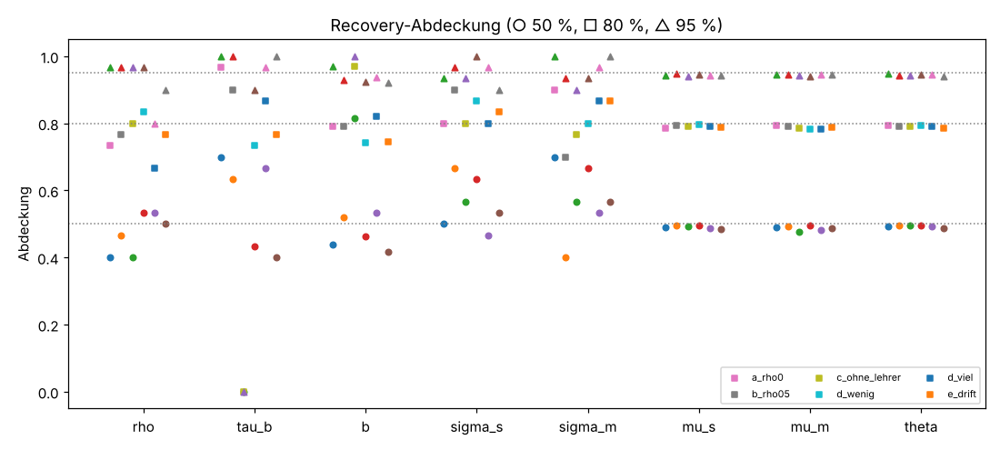
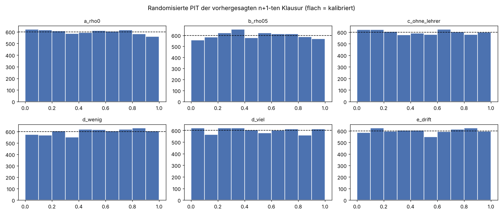
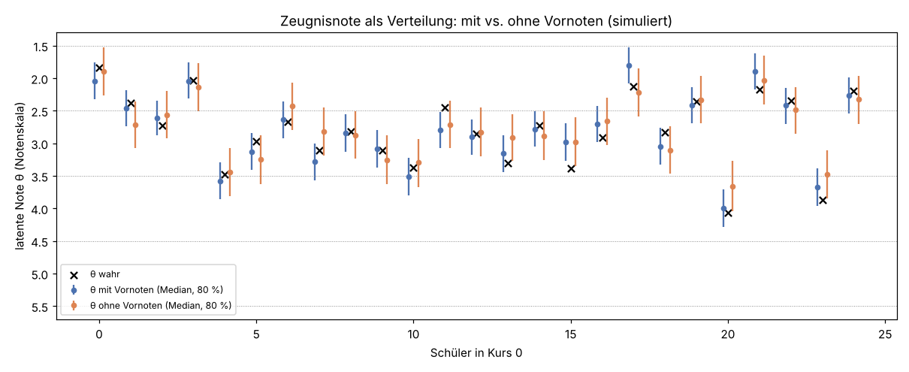

# Ergebnisse – hierarchisches Bayes-Modell zur Zeugnisnote

> Ausschließlich **simulierte Daten** (Seeds fest, siehe `scripts/run_experiments.py`). Modell und
> Annahmen: [`README.md`](../README.md). Alle Zahlen sind aus den Dateien in `tables/` übernommen.
> Rohdaten der Recovery-Läufe stehen in `results/recovery_runs.jsonl`.

**Setup:** 8 Kurse × 25 Schüler. Basisdesign: 3 Klausuren + 5 mündliche Noten + 3 Vornotenjahre
(+1 zurückgehaltene Klausur). Je Kernszenario gibt es 30 Simulationsläufe (insgesamt 180 Fits).
Gesampelt wird mit NUTS (nutpie), 4 Ketten × 1500 Draws, 1000 Tuning-Schritte.

| Szenario | Unterschied zur Basis |
|---|---|
| a_rho0 | ρ = 0 (echte Unabhängigkeit) |
| b_rho05 | **Basis**: ρ = 0,5, Lehrereffekt τ_b = 0,3, σ_drift = 0,3 |
| c_ohne_lehrer | τ_b = 0 |
| d_wenig / d_viel | 2 + 2 bzw. 6 + 10 Noten statt 3 + 5 |
| e_drift | σ_drift = 1,2 (Vornoten stark gedriftet) |

## Kurzfazit

1. **Die Unabhängigkeitsannahme ρ = 0 trägt nicht, wenn die Kanäle tatsächlich korreliert sind.
   Sie schadet aber wenig.** ρ ist gut identifiziert. Bei wahrem ρ = 0,5 schließt das 95-%-Intervall
   die 0 in 100 % der Läufe aus. Bei wahrem ρ = 0 schließt es die 0 nur in 3 % der Läufe aus. Im
   LOO-Vergleich verliert das ρ = 0-Modell bei korrelierten Daten nur 2–7 elpd-Punkte (≈ 2 SE). Das
   Modell mit freiem ρ verliert bei wirklich unabhängigen Daten nichts. **Empfehlung: ρ frei schätzen.**
2. **Intervallbreite bei realistischer Datenmenge (3 Klausuren + 5 mündliche Noten + Vornoten):**
   Das 80-%-Intervall von θ ist im Mittel **0,57 Notenpunkte** breit. Als Note umfasst es im Mittel
   **1,6 Notenstufen**. Nur **44 %** der Schüler bekommen eine eindeutige Note (Intervall = eine Stufe),
   die übrigen ein Intervall wie „2–3“. Ohne Vornoten ist das Intervall 0,74 Punkte breit, und nur
   24 % bekommen eine eindeutige Note.
3. **Die Kalibrierung ist gut.** Die Abdeckung von μ_s, μ_m und θ liegt in allen Szenarien bei
   0,49/0,79/0,94 (Soll 0,50/0,80/0,95). Bei der Vorhersage der nächsten Klausur liegt die
   randomisierte PIT bei 0,79–0,81 (Soll 0,80).
4. **Wo das Modell versagt:**
   - Bei stark gedrifteten Vornoten wird σ_drift deutlich unterschätzt (Abdeckung 0 %).
   - Die Sampler-Diagnostik verfehlt in 19 % der Fits knapp das Kriterium, meist wegen τ_b.
   - Den Lehrereffekt τ_b = 0 kann das Modell prinzipbedingt nicht „treffen“.

   Details siehe unten.

## 1. Prior Predictive Check

| Größe | Anteil 1 | 2 | 3 | 4 | 5 | 6 | P(> 80 % eine Note) | P(> 50 % Note 1 oder 6) |
|---|---|---|---|---|---|---|---|---|
| Klausuren S | 0,13 | 0,15 | 0,21 | 0,22 | 0,16 | 0,13 | 0,030 | 0,061 |
| Mündlich M | 0,13 | 0,15 | 0,22 | 0,23 | 0,15 | 0,12 | 0,020 | 0,054 |
| Zeugnisnote aus θ | 0,04 | 0,15 | 0,29 | 0,31 | 0,16 | 0,05 | 0,118 | 0,009 |

Die Priors erzeugen plausible, breite Notenverteilungen mit Mittel ≈ 3,5. Kursverteilungen mit
„fast alles 1“ oder „fast alles 6“ sind selten (< 7 % der Prior-Draws). Die Priors sind damit schwach
informativ, aber nicht absurd. Etwas zu breit ist, dass auch Kurse mit Mittel 2 oder 5 a priori gut
möglich sind (`figures/prior_predictive_moments.png`). Für reale Daten wäre ein engerer α-Prior
vertretbar.

## 2. Sampler-Diagnostik

Kriterium je Fit: R-hat < 1,01, ESS bulk/tail > 400, keine Divergenzen.

| Szenario | Fits | ok | max R-hat | min ESS bulk | min ESS tail | Divergenzen | s/Fit (1 Kern) |
|---|---|---|---|---|---|---|---|
| a_rho0 | 30 | 18 | 1,02 | 422 | 743 | 0 | 52 |
| b_rho05 | 30 | 25 | 1,01 | 446 | 786 | 0 | 56 |
| c_ohne_lehrer | 30 | 29 | 1,02 | 538 | 772 | 0 | 56 |
| d_wenig | 30 | 26 | 1,01 | 564 | 820 | 0 | 47 |
| d_viel | 30 | 21 | **1,04** | **226** | **396** | 0 | 79 |
| e_drift | 30 | 26 | 1,01 | 497 | 664 | 0 | 55 |

**145 von 180 Fits (81 %) erfüllen alle Kriterien. Divergenzen gab es in keinem Fit.** Die Ausreißer
sind fast immer knappe R-hat-Werte von 1,010–1,017. Nur zwei `d_viel`-Fits liegen deutlich darüber
(R-hat 1,035 bzw. 1,020, ESS 226 bzw. 237). Wo die Variable protokolliert wurde (spätere Läufe), war
die schlechteste Variable **τ_b** (7×) bzw. **α** (2×). Das ist die bekannte Schwäche hierarchischer
Varianzen bei nur 8 Gruppen.

Reparametrisierung: **Versuch 1** ersetzte die unabhängigen Kurseffekte durch Zero-Sum-Kurseffekte.
Vorher lag R-hat bei 1,03 und ESS bei 210 für α/δ_v/b (Kamm zwischen α und mean(b)); danach war das
gelöst. Einen zweiten Versuch (z. B. engerer τ_b-Prior oder mehr Draws) habe ich **bewusst nicht**
unternommen, um das Ergebnis nicht wegzutunen. Die Recovery-Tabellen enthalten alle 180 Fits,
inklusive der nicht bestandenen. Beschränkt man sich auf die bestandenen Fits, bleibt die
80-%-Abdeckung von μ_s und θ gleich (0,79). Für ρ steigt sie leicht von 0,76 auf 0,79, für b von 0,81
auf 0,82 (über alle Szenarien; `results/recovery_rows.csv`, Spalte `ok`).

## 3. Parameter-Recovery

Anteil der Läufe (bei Vektoren: aller Elemente über alle Läufe), deren wahrer Wert im zentralen
Posterior-Intervall liegt. Vergleichswerte sind passend zur Parametrisierung:
- b_t − mean(b) und α_c + mean(b),
- δ_v − mean(b),
- σ_v,eff = sqrt(σ_v² + 1/12), weil σ_v auch den Rundungsfehler der Vornoten aufnimmt.

**80-%-Intervalle (Soll 0,80)**

| Parameter | a_rho0 | b_rho05 | c_ohne_lehrer | d_wenig | d_viel | e_drift |
|---|---|---|---|---|---|---|
| μ_s (200/Lauf) | 0,78 | 0,80 | 0,79 | 0,80 | 0,79 | 0,79 |
| μ_m (200/Lauf) | 0,79 | 0,79 | 0,79 | 0,78 | 0,78 | 0,79 |
| θ (200/Lauf) | 0,79 | 0,79 | 0,79 | 0,79 | 0,79 | 0,79 |
| ρ | 0,73 | 0,77 | 0,80 | 0,83 | 0,67 | 0,77 |
| b_t (8/Lauf) | 0,79 | 0,79 | 0,97 | 0,74 | 0,82 | 0,75 |
| τ_b | 0,97 | 0,90 | **0,00** | 0,73 | 0,87 | 0,77 |
| σ_s | 0,80 | 0,90 | 0,80 | 0,87 | 0,80 | 0,83 |
| σ_m | 0,90 | 0,70 | 0,77 | 0,80 | 0,87 | 0,87 |
| τ_s | 0,87 | 0,80 | 0,87 | 0,77 | 0,93 | 0,83 |
| τ_m | 0,80 | 0,57 | 0,93 | 0,83 | 0,67 | 0,63 |
| α_s | 0,70 | 0,67 | 0,70 | 0,80 | 0,67 | 0,83 |
| α_m | 0,87 | 0,73 | 0,80 | 0,93 | 0,70 | 0,80 |
| Schwellen c₂–c₄ | 0,87 | 0,76 | 0,77 | 0,86 | 0,81 | 0,78 |
| σ_drift | 0,80 | 0,77 | 0,67 | 0,80 | 0,87 | **0,00** |
| σ_v,eff | 0,90 | 0,80 | 0,67 | 0,77 | 0,73 | **0,30** |
| δ_v ¹ | 0,80 | 0,70 | 0,90 | 0,90 | 0,75 | **0,47** |

**50 % / 95 %** (Auszug; vollständig in `tables/recovery_cov50.md`, `tables/recovery_cov95.md`):

| Parameter | a_rho0 | b_rho05 | c_ohne_lehrer | d_wenig | d_viel | e_drift |
|---|---|---|---|---|---|---|
| θ 50 % / 95 % | 0,49 / 0,95 | 0,50 / 0,94 | 0,49 / 0,94 | 0,50 / 0,94 | 0,49 / 0,95 | 0,49 / 0,94 |
| ρ 50 % / 95 % | 0,40 / 0,97 | 0,47 / 0,97 | 0,40 / 0,97 | 0,53 / 0,97 | 0,53 / 0,80 | 0,50 / 0,90 |
| b_t 50 % / 95 % | 0,44 / 0,97 | 0,52 / 0,93 | 0,82 / 1,00 | 0,46 / 0,93 | 0,53 / 0,94 | 0,42 / 0,92 |
| σ_drift 50 % / 95 % | 0,43 / 0,97 | 0,47 / 0,93 | 0,40 / 0,83 | 0,53 / 0,93 | 0,53 / 0,97 | **0,00 / 0,00** |

¹ **δ_v, eigener Fehler und Korrektur:** In den ersten 130 Fits war der Vergleichswert für δ_v
falsch definiert. Ich hatte δ_v statt δ_v − mean(b) genommen; der Fehler korrelierte zu 0,94 mit
−mean(b). Die Abdeckung war dadurch künstlich niedrig (≈ 0,5 bei 95 %). Das lag am Auswertecode,
nicht am Modell. Nach der Korrektur habe ich δ_v für a–d mit identischen Seeds in 10 Läufen je
Szenario nachgerechnet (`delta_fix/`); `d_viel` (20 Läufe) und `e_drift` (30 Läufe) liefen bereits
mit dem korrigierten Code. Mit nur 10 Läufen ist der Standardfehler der Abdeckung ≈ 13 Prozentpunkte.

**Lesart:**

* Die Abdeckung der **Schülerniveaus μ und der Zeugnisnote θ ist in allen Szenarien nominal**, auch
  bei gedrifteten Vornoten und wenigen Daten. Das ist die für die Note entscheidende Größe. Der Bias
  ist ≤ 0,015 Notenpunkte.
* **Einzelne Populationsparameter** schwanken mit dem Standardfehler von ≈ 7 Prozentpunkten (30 Läufe)
  um 0,80. Auffällig niedrig sind τ_m in b_rho05 (0,57), ρ in d_viel (0,67; 95 %: 0,80) und α_s
  (0,67–0,70). Das liegt am Rand des statistisch Erklärbaren. Eine systematische Unterdeckung von ρ bei
  viel Daten kann ich mit 30 Läufen nicht ausschließen: Der Posterior von ρ wird dort schmal, und kleine
  Fehlspezifikationen (abgeschnittene Vornoten) fallen stärker ins Gewicht.
* **τ_b = 0 (Szenario c):** Abdeckung 0, und das prinzipbedingt. Ein Half-Normal-Posterior hat
  den wahren Wert 0 nie im Inneren eines zentralen Intervalls. Der Posterior-Median ist aber klein
  (0,05), und die b_t werden korrekt auf ≈ 0 geschrumpft (b-Abdeckung 0,97, RMSE 0,02).
* **e_drift, echtes Versagen:** σ_drift wird stark unterschätzt (Median ≈ 0,93 statt 1,2, Bias −0,28,
  Abdeckung 0 %). σ_v,eff und δ_v sind ebenfalls verzerrt. Ursache ist die bewusst nicht modellierte
  **Begrenzung der Vornoten auf 1–6**: Bei starker Drift liegen 32 % der Vornoten am Rand (1 oder 6),
  im Basisszenario nur 6 %. Das Abschneiden staucht die Varianz, und das Modell liest weniger Drift
  heraus. **Auf μ und θ schlägt das kaum durch** (Abdeckung 0,79), weil das Modell die Vornoten trotzdem
  stark heruntergewichtet. Abhilfe wäre, die Vornoten ordinal oder zensiert zu modellieren (offener Punkt).

### Identifizierbarkeit von ρ

| Szenario | wahres ρ | Ø Posterior-Median | Ø 95-%-Intervall | Anteil 95-%-KI ohne 0 |
|---|---|---|---|---|
| a_rho0 | 0,0 | −0,01 | [−0,17; 0,15] | 0,03 |
| b_rho05 | 0,5 | 0,48 | [0,34; 0,60] | 1,00 |
| c_ohne_lehrer | 0,5 | 0,47 | [0,33; 0,59] | 1,00 |
| d_wenig | 0,5 | 0,48 | [0,33; 0,61] | 1,00 |
| d_viel | 0,5 | 0,49 | [0,37; 0,60] | 1,00 |
| e_drift | 0,5 | 0,49 | [0,32; 0,62] | 1,00 |

ρ ist bei 200 Schülern gut identifiziert, auch mit nur 2 + 2 Noten. Ein Grund ist, dass die
kanalgetrennten Vornoten zusätzliche Information über die Korrelation der Niveaus liefern. Es gibt
eine leichte Schrumpfung Richtung 0 (−0,01 bis −0,03) durch den LKJ(2)-Prior.

## 4. Kalibrierung: Vorhersage der n+1-ten Klausur

Gefittet wurde auf n Klausuren (2, 3 oder 6), vorhergesagt die zurückgehaltene nächste Klausur je
Schüler (30 Läufe × 200 Schüler je Szenario).

| Szenario | n | Treffer im 80-%-Intervall | vorhergesagte Masse des Intervalls | randomisierte PIT ∈ (0,1; 0,9) | Ø Breite (Notenstufen) | Log-Score |
|---|---|---|---|---|---|---|
| a_rho0 | 3 | 0,940 | 0,937 | **0,803** | 2,94 | −1,182 |
| b_rho05 | 3 | 0,938 | 0,935 | **0,812** | 2,93 | −1,174 |
| c_ohne_lehrer | 3 | 0,931 | 0,935 | **0,797** | 2,92 | −1,192 |
| d_wenig | 2 | 0,936 | 0,936 | **0,803** | 2,96 | −1,194 |
| d_viel | 6 | 0,936 | 0,937 | **0,794** | 2,87 | −1,162 |
| e_drift | 3 | 0,940 | 0,935 | **0,803** | 3,01 | −1,204 |

**Die Vorhersage ist kalibriert.** Weil Noten diskret sind, enthält das zentrale 80-%-Intervall
[q₁₀, q₉₀] tatsächlich ≈ 93,5 % Wahrscheinlichkeitsmasse. Die Trefferquote (≈ 93,5 %) stimmt mit
dieser Sollmasse überein. Die randomisierte PIT liegt bei 0,79–0,81 (SD über Läufe ≈ 0,03); die
Histogramme sind flach (`figures/calibration_pit.png`).

**Ehrliche Einordnung:** Eine einzelne Klausurnote ist sehr unsicher. Das 80-%-Vorhersageintervall
umfasst ≈ 3 Notenstufen (z. B. „2–4“). Das liegt an der Einzelnotenstreuung σ_s ≈ 0,7 und nicht an
der Unsicherheit über den Schüler. Mehr Vorinformation hilft deshalb kaum: Die Breite sinkt von
n = 2 auf n = 6 nur von 2,96 auf 2,87.

## 5. Modellvergleich per LOO

Punktweises PSIS-LOO auf den **aktuellen** Noten (S und M, 1600 Beobachtungen). Die Vornoten gehen
nicht in die Likelihood ein, damit Modelle mit und ohne Vornoten vergleichbar sind. Es gibt je
3 Datensätze pro Szenario. Angegeben ist der Mittelwert der elpd-Differenz zum besten Modell des
jeweiligen Datensatzes; der SE ist der der paarweisen Differenz.

| Szenario | Variante | Ø Δelpd | Ø SE(Δ) | Anteil Rang 1 | Σ k > 0,7 (über 3 Fits) | max k |
|---|---|---|---|---|---|---|
| a_rho0 (ρ=0) | voll | −0,06 | 0,19 | 0,67 | 0 | 0,59 |
| | ρ = 0 | −0,06 | 0,31 | 0,33 | 0 | 0,67 |
| | ohne Lehrer | −21,2 | 6,5 | 0 | 0 | 0,57 |
| | ohne Vornoten | −76,0 | 12,3 | 0 | 5 | 0,77 |
| b_rho05 | voll | −0,41 | 0,69 | 0,67 | 0 | 0,60 |
| | ρ = 0 | −3,25 | 1,87 | 0,33 | 0 | 0,61 |
| | ohne Lehrer | −38,8 | 8,4 | 0 | 0 | 0,56 |
| | ohne Vornoten | −66,6 | 12,1 | 0 | 6 | 0,79 |
| c_ohne_lehrer (τ_b=0) | ohne Lehrer | −0,08 | 0,80 | 0,67 | 0 | 0,60 |
| | voll | −0,62 | 1,04 | 0 | 1 | 0,70 |
| | ρ = 0 | −2,35 | 1,88 | 0,33 | 0 | 0,64 |
| | ohne Vornoten | −63,4 | 12,0 | 0 | 5 | 0,88 |
| e_drift (σ_drift=1,2) | voll | 0 | 0 | 1,00 | 1 | 0,77 |
| | ohne Lehrer | −5,6 | 3,7 | 0 | 1 | 0,78 |
| | ρ = 0 | −6,9 | 3,6 | 0 | 4 | 0,90 |
| | ohne Vornoten | −12,8 | 6,4 | 0 | 7 | 0,84 |

* **ρ = 0 vs. ρ frei:** Bei wahrem ρ = 0 sind beide gleichwertig (Δ ≈ 0). Bei ρ = 0,5 ist das freie
  Modell besser, aber nur um 2–7 elpd-Punkte (1,3–1,9 SE). Das ist eine schwache, aber konsistente
  Präferenz. Die LOO-Differenz ist ein schwächeres Signal als der direkte Posterior von ρ (Abschnitt 3).
* **Vornoten** bringen mit Abstand den größten Gewinn (63–76 elpd-Punkte). Selbst bei starker Drift
  sind es noch 13 (≈ 2 SE).
* **Lehrereffekt:** Er ist nötig, wenn er existiert (21–39 Punkte). Wenn er nicht existiert, kostet das
  volle Modell praktisch nichts (−0,6 ± 1,0). Partial Pooling funktioniert also wie gewünscht.
* **Pareto-k:** In keinem der 48 Fits ist ein k > 1; das höchste k liegt bei 0,90. Werte > 0,7 treten
  fast nur im Modell **ohne Vornoten** auf (bis 4 von 1600 Beobachtungen je Fit) und im ρ = 0-Modell
  bei e_drift. Ursache: Ohne Vornoten hängt μ_i allein an 3 + 5 Noten, und das Weglassen einer extremen
  Note verschiebt den Posterior stark. Die betroffenen Anteile (≤ 0,25 %) sind zu klein, um die
  Rangfolge zu ändern. Für eine strenge Auswertung müssten diese Punkte per Moment-Matching oder
  exaktem Refit (reloo) geprüft werden; das habe ich nicht gemacht.
* 6 der 48 LOO-Fits verfehlen knapp das R-hat-Kriterium (siehe `tables/loo_compare.md`, Spalte `diag_ok`).

## 6. Prior-Sensitivität der Vornoten

Ein Datensatz je Szenario, gefittet mit drei Half-Normal-Skalen für σ_drift **und** σ_v:
0,05 („stark“: Vornoten gelten als sehr verlässlich), 0,5 (Default) und 2,0 („schwach“). Jeweils mit
3 und mit nur 1 Vornotenjahr. Δθ ist die Verschiebung des θ-Medians gegenüber dem Default.

| Szenario | Jahre | Prior | σ_drift (post.) | Ø \|Δθ\| | max \|Δθ\| | Note geändert | θ-Breite 80 % | RMSE θ |
|---|---|---|---|---|---|---|---|---|
| b_rho05 | 3 | stark | 0,27 | 0,014 | 0,05 | 0,5 % | 0,54 | 0,221 |
| | | default | 0,29 | – | – | – | 0,56 | 0,221 |
| | | schwach | 0,29 | 0,004 | 0,01 | 0 % | 0,56 | 0,221 |
| b_rho05 | 1 | stark | 0,28 | 0,052 | 0,18 | 6,0 % | 0,56 | 0,239 |
| | | default | 0,35 | – | – | – | 0,60 | 0,234 |
| | | schwach | 0,36 | 0,004 | 0,02 | 0,5 % | 0,60 | 0,233 |
| e_drift | 3 | stark | 0,78 | 0,039 | 0,12 | 3,0 % | 0,71 | 0,313 |
| | | default | 0,97 | – | – | – | 0,71 | 0,299 |
| | | schwach | 0,97 | 0,005 | 0,02 | 0 % | 0,71 | 0,298 |
| e_drift | 1 | stark | 0,63 | 0,074 | 0,26 | 8,5 % | 0,71 | 0,290 |
| | | default | 0,85 | – | – | – | 0,72 | 0,277 |
| | | schwach | 0,86 | 0,005 | 0,02 | 0 % | 0,72 | 0,278 |

* **Mit 3 Vornotenjahren ist das Ergebnis robust.** Die Verschiebung liegt im Mittel unter 0,04
  Notenpunkten, die Note ändert sich bei höchstens 3 % der Schüler. σ_drift wird aus den Daten gelernt.
* Mit **nur 1 Vornotenjahr** und dem **starken** Prior verschieben sich θ-Mediane um bis zu 0,26 und
  die Note bei 6–9 % der Schüler. Bei gedrifteten Vornoten steigt dann der Fehler (RMSE 0,290 statt
  0,277). Mit einem Vornotenjahr sind σ_drift und σ_v nicht getrennt identifiziert (siehe README), und
  der Prior entscheidet mit. Ein zu optimistischer Prior zur Verlässlichkeit der Vornoten ist das
  Hauptrisiko. Ein schwacher Prior ist dagegen unkritisch.
* Einschränkung: Hier wurde je ein Datensatz verwendet. 5 der 12 Fits verfehlen knapp das R-hat-Kriterium.

## 7. Zeugnisnote mit und ohne Vornoten

Datensatz b_rho05 (Seed 900001), alle 200 Schüler in `results/noten_mit_ohne_vornoten.csv`,
Auszug Kurs 0:

| Schüler | Ø S | Ø M | Ø Vornote S | naiv gerundet | **mit Vornoten** | θ mit | **ohne Vornoten** | θ ohne | θ wahr | Note wahr |
|---|---|---|---|---|---|---|---|---|---|---|
| 0 | 1,67 | 1,80 | 1,67 | 2 | 2 [2–2] | 2,04 [1,76; 2,32] | 2 [2–2] | 1,90 [1,53; 2,27] | 1,83 | 2 |
| 1 | 2,67 | 2,80 | 1,67 | 3 | 2 [2–3] | 2,46 [2,18; 2,74] | 3 [2–3] | 2,71 [2,36; 3,07] | 2,38 | 2 |
| 2 | 2,33 | 2,80 | 2,67 | 2 | 3 [2–3] | 2,61 [2,34; 2,88] | 3 [2–3] | 2,56 [2,19; 2,92] | 2,72 | 3 |
| 3 | 2,00 | 2,00 | 2,33 | 2 | 2 [2–2] | 2,04 [1,76; 2,31] | 2 [2–3] | 2,14 [1,77; 2,51] | 2,03 | 2 |
| 4 | 4,00 | 3,00 | 4,00 | 4 | 4 [3–4] | 3,57 [3,29; 3,85] | 4 [3–4] | 3,44 [3,07; 3,81] | 3,48 | 3 |
| 5 | 3,67 | 3,00 | 3,00 | 3 | 3 [3–3] | 3,13 [2,85; 3,41] | 3 [3–4] | 3,24 [2,88; 3,63] | 2,97 | 3 |
| 6 | 2,33 | 2,40 | 3,00 | 2 | 3 [2–3] | 2,63 [2,36; 2,92] | 2 [2–3] | 2,43 [2,06; 2,80] | 2,67 | 3 |
| 7 | 3,00 | 2,60 | 4,33 | 3 | 3 [3–4] | 3,28 [3,00; 3,57] | 3 [2–3] | 2,82 [2,45; 3,18] | 3,11 | 3 |
| 10 | 4,00 | 2,60 | 4,00 | 4 | 4 [3–4] | 3,51 [3,22; 3,80] | 3 [3–4] | 3,29 [2,93; 3,67] | 3,37 | 3 |
| 11 | 2,67 | 2,80 | 3,00 | 3 | 3 [3–3] | 2,79 [2,52; 3,07] | 3 [2–3] | 2,71 [2,35; 3,08] | 2,45 | 2 |

Zusammenfassung über alle 200 Schüler:

| Verfahren | Ø Breite θ (80 %) | Ø Breite Note (Stufen) | eindeutige Note | Median = wahre Note | wahre Note im 80-%-Intervall | RMSE θ |
|---|---|---|---|---|---|---|
| mit Vornoten | 0,56 | 1,55 | 46 % | **85 %** | 98 % | **0,197** |
| ohne Vornoten | 0,74 | 1,76 | 24 % | 78 % | 99 % | 0,274 |
| naiv: gewichteter Schnitt, gerundet | – | – | – | 76 % | – | 0,279 |

* **Mit Vornoten** ist die Note genauer (RMSE −28 %) und häufiger eindeutig. Ohne Vornoten ist das
  Modell kaum besser als der gerundete gewichtete Schnitt. Sein Mehrwert liegt dann in der
  **ausgewiesenen Unsicherheit**, nicht in der Punktschätzung.
* Beispiel Schüler 1: aktueller Schnitt ≈ 2,7, aber starke Vornoten (1,67). Mit Vornoten ergibt sich
  „2 [2–3]“, ohne „3 [2–3]“; die wahre Note ist 2. Umgekehrt zieht bei Schüler 7 eine schwache
  Vornotenhistorie die Note Richtung 4, mit Intervall „3 [3–4]“.
* Die 80-%-Intervalle der **Note** sind wegen der Diskretisierung konservativ: Sie enthalten die
  wahre Note in 97–98 % der Fälle (Recovery, alle Szenarien) statt in 80 %. Für θ selbst ist die
  Abdeckung nominal.

### Intervallbreite nach Datenmenge (Recovery, je 30 Läufe)

| Szenario | Ø Breite θ (80 %) | Ø Breite Note (Stufen) | eindeutige Note | Median = wahre Note | P(wahre Note) |
|---|---|---|---|---|---|
| d_wenig (2 + 2) | 0,64 | 1,63 | 37 % | 80 % | 0,72 |
| b_rho05 (3 + 5) | 0,57 | 1,57 | 44 % | 82 % | 0,75 |
| d_viel (6 + 10) | 0,47 | 1,47 | 53 % | 85 % | 0,79 |
| e_drift (3 + 5, Vornoten gedriftet) | 0,71 | 1,70 | 30 % | 77 % | 0,68 |

Selbst mit einem vollen Schuljahr an Noten (6 + 10) ist bei rund der Hälfte der Schüler mehr als
eine Note mit dem Datenbild verträglich. Die Ganzzahl-Zeugnisnote suggeriert also eine Genauigkeit,
die die Daten nicht hergeben. Am größten ist die Unsicherheit für Schüler nahe einer Notengrenze.

## Wo versagt das Modell? / offene Punkte

1. **Abgeschnittene Vornoten (1/6) bei starker Drift:** σ_drift wird um ≈ 25 % unterschätzt, σ_v und
   δ_v sind verzerrt. Lösung: die Vornoten ordinal (gleiche Probit-Struktur) oder zensiert modellieren.
2. **Sampler-Effizienz von τ_b bei 8 Kursen:** 19 % der Fits haben knapp R-hat > 1,01, einzelne mit ESS
   < 400 (d_viel). Zu prüfen wären mehr Draws, ein informativerer τ_b-Prior oder mehr Kurse. Den zweiten
   Reparametrisierungsversuch habe ich nicht ausgeschöpft.
3. **ρ bei sehr vielen Daten:** Die 95-%-Abdeckung von 0,80 in d_viel sollte mit mehr Läufen geprüft
   werden (möglicherweise Fehlspezifikation durch Punkt 1).
4. **τ_b = 0 ist mit Half-Normal nicht „treffbar“.** Wenn die Frage „gibt es überhaupt einen
   Lehrereffekt?“ wichtig ist, braucht man einen Modellvergleich (LOO zeigt hier keinen Nachteil des
   vollen Modells) oder einen Spike-and-Slab-Ansatz.
5. **Pareto-k > 0,7** (vereinzelt, v. a. ohne Vornoten) ist nicht per reloo nachgeprüft.
6. **Recovery ist frequentistisch bei fester Wahrheit**, keine volle SBC; Prior-Sensitivität beruht auf
   je einem Datensatz.
7. **Der dritte Kanal D (Lehrerurteil)** ist implementiert und getestet (Smoketest), aber nicht in der
   Simulationsstudie ausgewertet.
8. **Speicherwachstum der Worker** (≈ 100 MB pro Fit) führte einmal zum Abbruch des Recovery-Laufs.
   Er wurde fortgesetzt; seitdem werden die Worker alle 8 Fits neu gestartet.
9. **Übertragbarkeit:** Alle Aussagen gelten für das simulierte Design. Echte Noten haben vermutlich
   zusätzliche Strukturen (Trends innerhalb des Halbjahres, unterschiedliche Klausurschwierigkeit,
   Ausreißer), die das Modell nicht abbildet.
